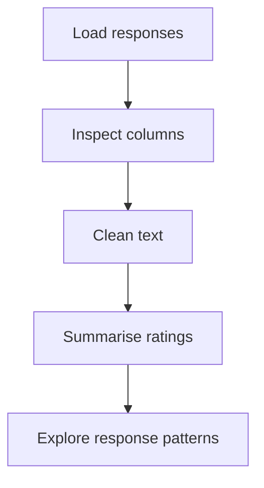

<div align="center"><h1>💬 THE FEEDBACK LAB</h1><p>TEXT CLEANING · RATING SUMMARIES · PANDAS</p>  </div>

## Lab bench


## Notebook station
<p align="center"><a href="Survey_Feedback_Analyzer.ipynb"></a></p>

| EXPERIMENT | INSPECT |
|---|---|
| Load | Shape, columns and data types |
| Clean | Missing values and text normalization |
| Rate | Summary statistics and distributions |
| Explore | Frequent words and response patterns |

## Reproduce the lab
```bash
pip install pandas jupyter
jupyter notebook
```
Open the notebook and run cells from top to bottom.

**Scope note:** Word frequency is not sentiment analysis. Findings should not be generalized beyond the supplied sample.