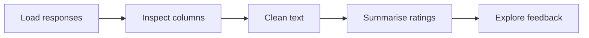

# 💬 SURVEY FEEDBACK ANALYZER
### A guided notebook walkthrough

<p align="center">  </p>

## The notebook route


## Notebook launch
<p align="center"><a href="Survey_Feedback_Analyzer.ipynb"></a></p>

## Lab worksheet
| Notebook section | What to inspect |
|---|---|
| Loading | Source structure and fields |
| Cleaning | Missing values and text normalization |
| Ratings | Summary statistics and distributions |
| Feedback | Common words and response patterns |

## Reproduce this exercise
```bash
pip install pandas jupyter
jupyter notebook
```
Open the notebook and run cells from top to bottom.

**Scope:** Text frequency is not sentiment analysis. Survey patterns should not be generalized beyond the supplied sample.